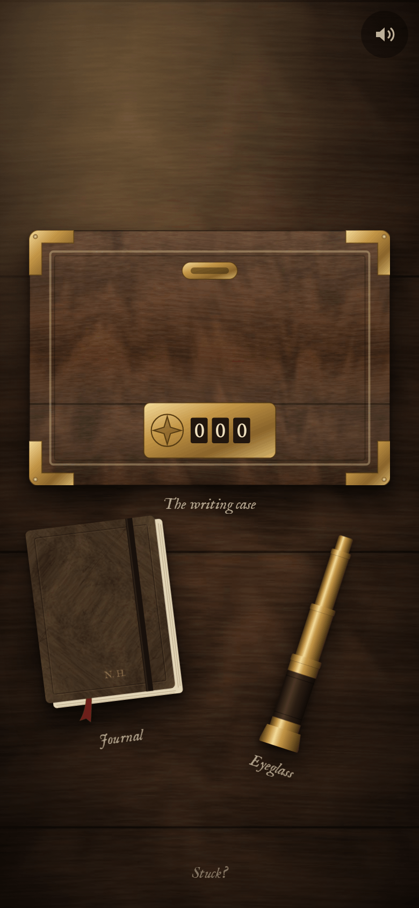
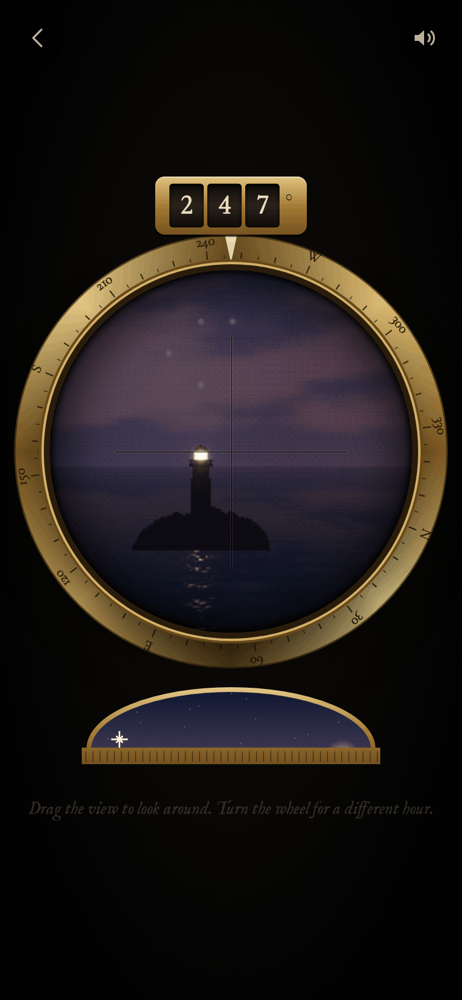
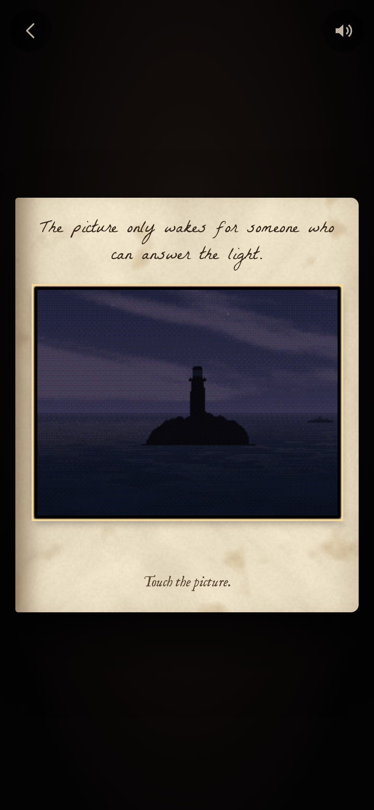

# Lanthorn

**Play it: [junkdrawer.works/lanthorn](https://junkdrawer.works/lanthorn/)**

**A locked writing case, a journal and a brass eyeglass, left in a cupboard by someone who wrote a world and went into it.** Through the eyeglass you can watch that world, one rock with a lighthouse and the sea all the way round, at any hour you like. At dusk a second rock appears that she never wrote, and after dark a light on it flashes the same thing all night. Open the case, then the book inside it, and follow her.

<p align="center">
  
  &nbsp;
  
  &nbsp;
  
</p>

## How it plays

- **Tap the things on the desk** to look at them: the journal, the eyeglass and the case. The back arrow puts them down again.
- **The journal** is Nell Harrow’s, one entry to a page, with her sketches. Swipe or use the arrows to turn pages.
- **Drag the view in the eyeglass** to look around, and up or down. The counter above it is the compass bearing of whatever is in the crosshairs. **Turn the brass wheel** underneath to look at a different hour; the sun, or the lamp star opposite it, crosses the little arch of sky.
- **Three locks**, each opened by something you can only learn by watching: where the far light stands, what stands over it, and what it says. The case has three number wheels, the book has a plate of brass studs, and the picture inside the book answers to taps (short) and holds (long).
- **Touch the picture when it wakes** and it takes you across. There’s one more thing to do on the other side.
- **Whatever you do at the end is kept.** Start again and the far light is yours, so the next person to play on your phone watches you. Turn the sound on: the wind, the sea, the bell buoy and the room are all made in the browser as you play.
- **Stuck?** on the desk gives a nudge for whichever lock you’re on, one hint at a time.
- No account and no server. Where you’ve got to stays in your browser. It works offline and installs to a phone’s home screen.

## Running it

It’s a static site: plain HTML, CSS and JavaScript, with no build step.

```sh
npx serve .                   # or any static file server, then open the printed address
npm test                      # the rules in Node, then plays it start to finish in Chromium (needs Playwright)
node tools/screenshots.mjs    # redraws docs/*.png and og.png (needs npm install)
node tools/make-icons.mjs     # redraws the PNG icons from icon.svg
npm run build                 # optional: dist/lanthorn.html, the whole thing in one file
```

Add `?at=desk`, `glass`, `case`, `book` or `far` to the address to jump to a screen, `&hours=19&heading=245` to set the eyeglass, and `?fresh` to start over.

To put it online with GitHub Pages: **Settings → Pages → Build and deployment → Deploy from a branch**, then pick `main` and `/ (root)`.

### Files

- `js/world.js`: Lanthorn itself, drawn a pixel at a time: the sun and sky for any hour, clouds, the sea, the rocks, the wreck, the buoy, the cairn, the two lighthouses, the stars that don’t move, the far light’s pattern, and the dither that makes it look like an old CD-ROM.
- `js/glass.js`: the eyeglass: dragging, the compass ring and counter, and the hour wheel.
- `js/book.js`: the star clasp and the linking picture, asleep and awake.
- `js/far.js`: the lamp room on the far rock, and the shutter.
- `js/app.js`: the desk, the journal, the case and moving between them.
- `js/text.js`: everything Nell wrote, and the hints. `js/sketches.js`: her drawings.
- `js/audio.js`: all the sound, made with Web Audio.
- `js/textures.js`: the wood, paper and leather, made on a canvas when the page opens.
- `js/store.js`: what you’ve opened so far, kept in localStorage.
- `fonts/`: IM Fell English, La Belle Aurore and Cormorant Garamond (SIL Open Font License), served from here so nothing loads from elsewhere.
- `sw.js`: keeps a copy for playing offline.
- `scripts/build.mjs`: bundles it into one HTML file.
